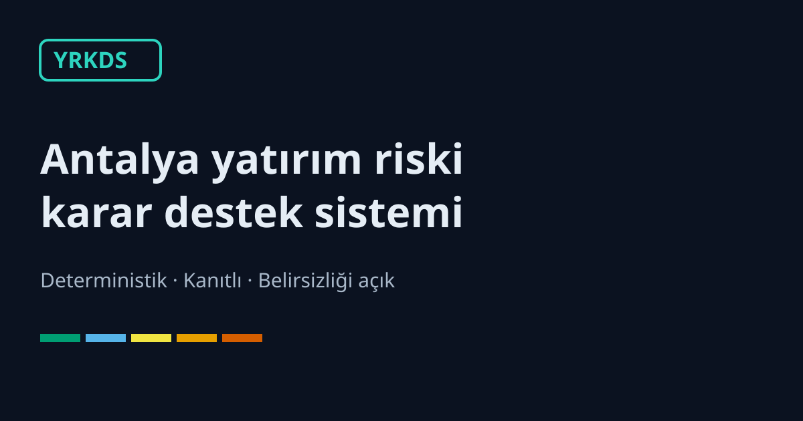

<!-- _class: lead -->
# Antalya Yatırım Riski Karar Destek Sistemi
## YRKDS v3.0 — Jüri Sunumu

<!-- Konuşma notu: 30 saniye. Projenin adını, amacını ve dürüstlük ilkesini vurgulayın. -->

---
## 1 — Problem

Aynı ilçede traverten, alüvyon, lagün ve falezler yan yana.

- Parsel bazlı hızlı ön-tarama yok
- İlçe ortalamaları yanıltıcı
- Kararın gerekçesi görünmüyor

<!-- Konuşma notu: Antalya jeolojisinin çeşitliliğini bir örnekle anlatın. -->

---
## 2 — Amaç

0–100 skor + kanıt + güven + yasal kısıt durumu.

- ML eğitimi yok, kurallar denetlenebilir
- Eksik veri = NULL + güven cezası
- Nihai karar yetkili mühendiste

<!-- Konuşma notu: Sistemin ne yapmadığını da söyleyin: yıkım tahmini yok. -->

---
## 3 — Veri

Açık portallar; her sayının manifest'te kaynağı var.

- DEM, SoilGrids WCS 250 m, OSM
- AFAD, MTA, MGM, Resmî Gazete
- SHA256 + erişim tarihi + lisans

<!-- Konuşma notu: 799.594 hücre, %100 DEM kapsamı. -->

---
## 4 — Algoritma

`skor = 100 × (0.25ZB + 0.20L + 0.25S + 0.15H + 0.15F)`

- Priority-flood + D8 + HAND
- VETO skoru ezer
- Kapsam < %50 ise skor yok

<!-- Konuşma notu: Formülü ve üst kuralları gösterin. -->

---
## 5 — Dünya standartları

ISO 31000, IPCC AR6, OGC, WCAG 2.2 AA.

- Yetkinlik rozetleri: Otorite/Proxy/Tahmin/Eksik
- FAIR datasheet + model kartı
- Tüm kapılar `make gate-all`

<!-- Konuşma notu: Standartların ürün davranışına nasıl yansıdığını örnekleyin. -->

---
## 6 — Demo senaryosu

Boğaçay parseli: çiz → analiz → PDF.

- Skor 48.3, bant Düşük-Orta
- S eksik → güven 0.383, "Koşullu"
- PDF 10+ sayfa, kanıt zincirli

<!-- Konuşma notu: Canlı demo burada yapılır: /harita.html. -->

---
## 7 — Sonuçlar

2009 seli: Precision 0.941, Recall 0.941.

- Wilson %95 CI [0.730, 0.990]
- İlçe bloklarıyla mekânsal ayrım
- Eşik kaydırma yok

<!-- Konuşma notu: Recall'ün geniş aralığını saklamayın. -->

---
## 8 — Duyarlılık

Morris: H %49.9, F %25.6, ZB/L %12.2.

- S örnekte NULL → etkisi sıfır
- ±%20 pertürbasyon, 2000 trajektör
- docs/duyarlilik.md

<!-- Konuşma notu: Bu bir model hatası değil, veri eksikliğinin yansıması. -->

---
## 9 — Ürün

Harita, what-if, portföy, embed, PWA.

- Kazıklı temel skoru düşürür (Tahmin)
- 5 parsel → 12 sayfa portföy PDF
- Belediye sitesine iframe

<!-- Konuşma notu: B1–B5 özelliklerini kısaca gösterin. -->

---
## 10 — Dürüst sınırlar

EGMS, SYGM pafta, TDTH grid yok.

- 2003/2008 bağımsız etiket yok
- Yasal geometriler geocode proxy
- ADR'lerle açıkça etiketli

<!-- Konuşma notu: Bu slayt jüri güvenini artırır; eksikliği saklamayın. -->

---
## 11 — Kalite

83+ test, %90+ kapsam, Lighthouse 100/100/100/91.

- Playwright + axe + k6 + ZAP
- SBOM + güvenlik taraması temiz
- Görsel regresyon snapshot'ları

<!-- Konuşma notu: Kapıların nasıl tek komutla çalıştığını gösterin. -->

---
## 12 — Gelecek ve kapanış

Resmi veri gelince Otorite rozetine yükselir.

- A1 EGMS, A2 bağımsız olay, resmi VETO sınırları
- Ticari ürün için lisans denetimi
- Dürüstlük ürün özelliğidir

<!-- Konuşma notu: Teşekkür edin ve soruları alın. -->
